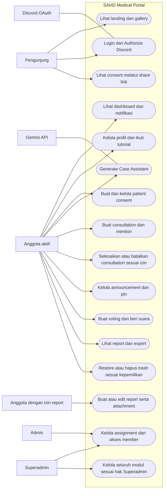
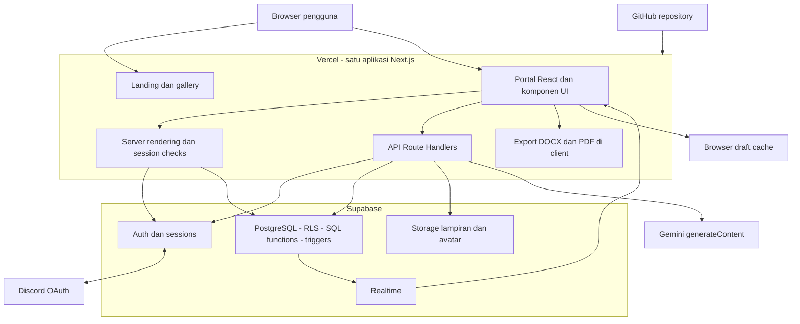
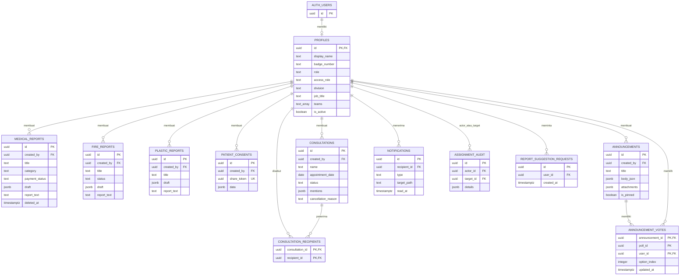
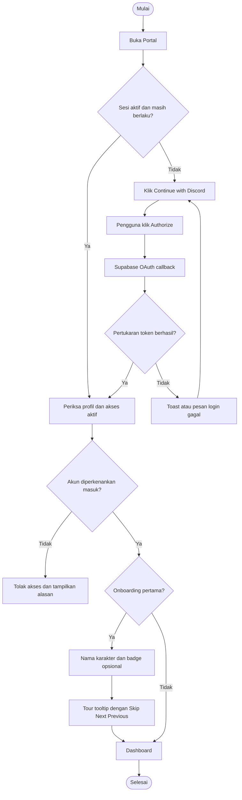
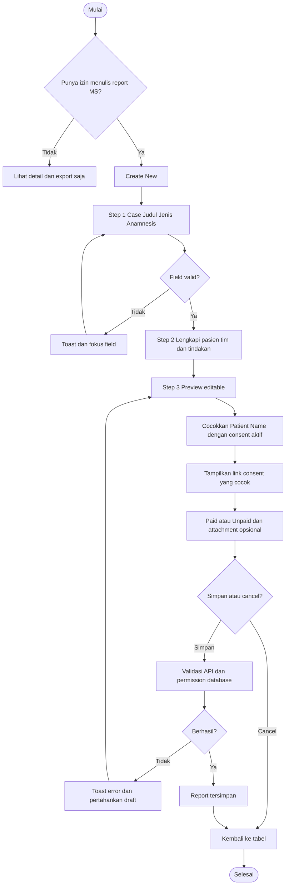
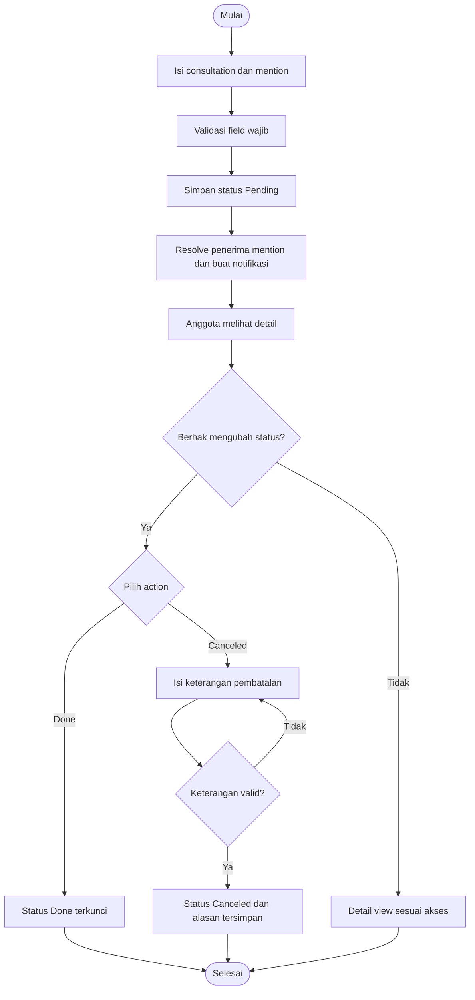
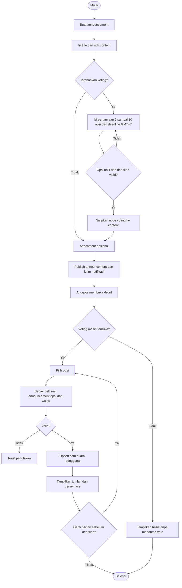
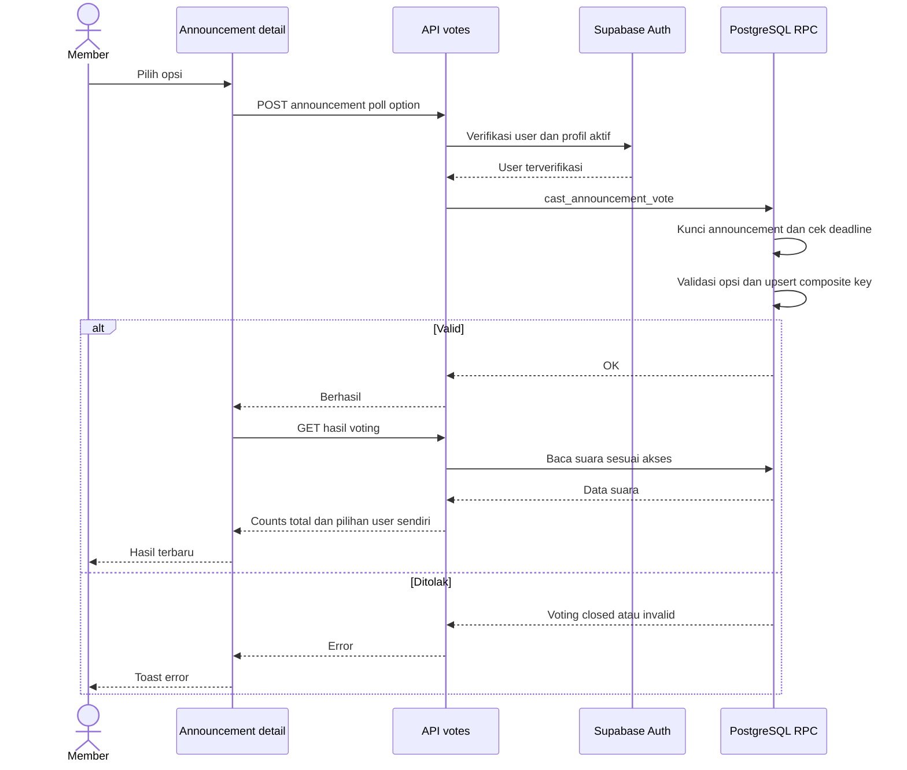
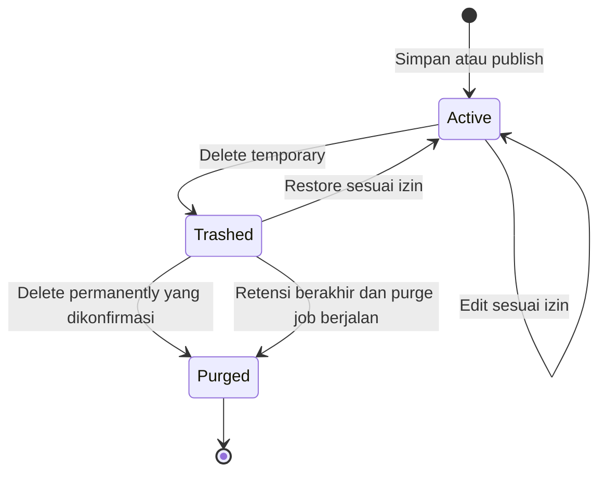
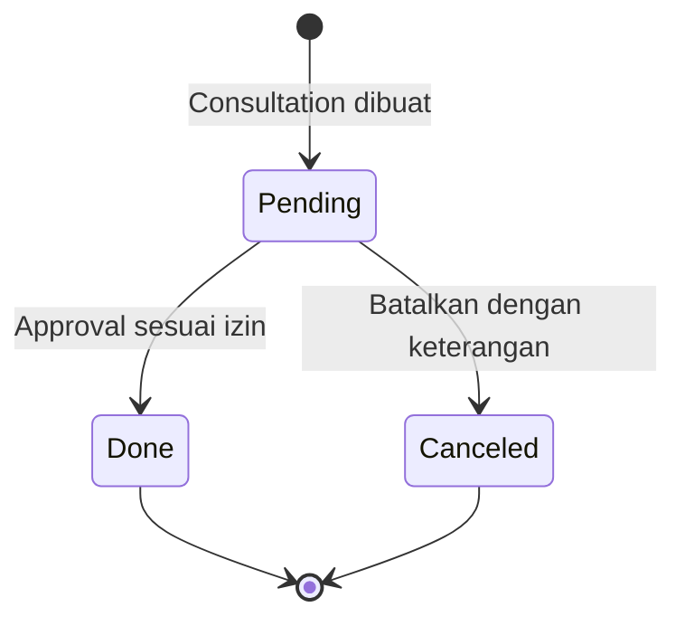

# SAHD Medical Portal — Tech Stack dan Rekap Seluruh Sprint

Tanggal pembaruan: **10 October 2026 (Asia/Jakarta)**.

Dokumen ini merangkum permintaan awal, revisi yang disepakati, implementasi, dan pekerjaan yang masih perlu dikonfirmasi. Ketika berbeda dengan dokumen sprint lama, keputusan terbaru di sini menjadi acuan. Status implementasi tidak berarti seluruh integrasi eksternal sudah teruji di produksi.

## 1. Tech Stack

| Lapisan | Teknologi | Pemakaian |
| --- | --- | --- |
| Framework | Next.js 16, App Router | Website publik, portal, routing, rendering, API Route Handlers |
| UI | React 19 | Komponen dan interaksi |
| Bahasa | TypeScript 5 | Pemeriksaan tipe frontend dan backend |
| Styling | Tailwind CSS 4 dan CSS custom | Responsive layout, tema divisi, light/dark mode |
| Komponen | shadcn/ui, Base UI, Radix UI | Select, date picker, dialog, dropdown, tabs, popover, switch |
| Animasi | Animate UI, Framer Motion, Motion | Button, sidebar, transisi dan interaksi |
| Ikon | Lucide React | Navigasi, toolbar, action menu |
| Rich text | Tiptap 3 | Bold, italic, underline, list, font, alignment, tabel; custom node voting |
| Pencarian pilihan | cmdk | Command search, pencarian member dan multiselect |
| Kalender | React Day Picker dan date-fns | Kalender, date range, format tanggal |
| Grafik | Recharts 3 | Overview Surgery dan Big Fire |
| Backend data | Supabase PostgreSQL | Profil, report, consent, consultation, announcement, voting, notifikasi |
| Authentication | Supabase Auth + Discord OAuth | Login Discord, sesi dan callback |
| Authorization | PostgreSQL RLS, SQL functions, pemeriksaan server | Pembatasan akses berdasarkan akun, divisi, jabatan, kepemilikan, mention |
| File | Supabase Storage | Avatar dan lampiran; akses melalui signed URL sesuai kebutuhan |
| Realtime | Supabase Realtime | Pembaruan notifikasi dan data yang berlangganan |
| AI | Gemini API melalui server | Case Assistant berupa teks untuk GTA RP |
| Export | docx, jsPDF, html-to-image | DOCX, PDF, preview gambar dokumen |
| Runtime | Node.js >=20.9 dan npm | Development, build, dependency management |
| Pengujian | Node.js test runner, TypeScript compiler, browser QA | Unit/regression tests, build, pemeriksaan interaksi |
| Source control | Git dan GitHub | Repository AisyahAuliaAngelinee/dashboard-sahd |
| Deployment | Vercel | Build dan deployment dari GitHub |

Versi dependency yang diminta tercatat pada `package.json`; versi terkunci ada di `package-lock.json`. shadcn/ui dan Animate UI juga berupa komponen source di repository.

### Domain dan lingkungan

- Portal produksi: **https://dashboard-sahd.vercel.app**.
- Keputusan terbaru: menggunakan domain bawaan Vercel untuk portal.
- Domain pribadi yang pernah dikonfigurasi: `clarishna.my.id`; registrasi Hostinger, nameserver pada screenshot mengarah ke Vercel.
- Development terakhir: `http://127.0.0.1:8766`.
- Supabase project: `hfcpsevrffbzqskfwnno`.
- `.env.local` hanya berlaku lokal; environment Vercel diatur terpisah dan memerlukan redeploy agar perubahan terbaca.
- Tidak ada secret/API key yang disalin ke dokumen ini.

## 2. Keputusan Produk Terbaru

1. Login pengguna menggunakan **Discord saja**. Register/email dan Google bukan alur login aktif saat ini.
2. Pengguna tetap mengklik **Authorize** Discord; persetujuan otomatis dibatalkan untuk mendukung pergantian akun.
3. Anggota baru mendapat akses **Member** dan jabatan **Trainee**.
4. Role organisasi hanya **SAHD**. Admin/Member/Superadmin adalah akses web, bukan role organisasi.
5. Jabatan dapat lebih dari satu; tabel dan Account Settings menampilkan beberapa badge.
6. Navbar menampilkan divisi dan hanya jabatan tertinggi untuk menghindari overflow.
7. Surgery Report diisi manual; tidak ada pembuatan narasi atau gambar otomatis di form report.
8. Gemini dipakai untuk **Case Assistant teks**. Gambar CT/MRI/X-Ray diunggah manual, opsional, lebih dari satu.
9. Announcement dibuka penuh untuk semua anggota aktif, termasuk Trainee. Ini menggantikan aturan awal Announcement view-only.
10. Dokumen dan skenario medis digunakan untuk **GTA Roleplay**, bukan layanan klinis nyata.

## 3. Sprint 1 — Fondasi Portal, Login, Dashboard, Account

### Ruang lingkup awal

- Navbar: logo, pencarian dengan shortcut Windows/macOS, notifikasi, account.
- Account dropdown: Account Settings dan Logout.
- General: nama, password untuk register, foto, toggle notifikasi, role dan divisi view-only.
- Members: anggota yang terdaftar.
- Login awal: register, Google, Discord.
- Dashboard: sapaan, announcement terbaru, grafik surgery, card minor/major, tabel janji temu.
- Filter analytics: all time, day, week, month, year, date range.
- Sidebar: Dashboard, Medical Service, Fire Department, Patient Consent, Case Assistant, Consultation, Announcement, Trash.

### Implementasi dan revisi

- Integrasi Supabase Auth; alur aktif kemudian dibatasi menjadi Discord-only.
- Avatar Discord dan nama profil ditampilkan di account.
- Dropdown, animasi masuk, pencarian, sidebar dan ukuran navbar disesuaikan.
- Logo menggunakan aset SAHD dengan subtitle Medical Portal.
- Sidebar mendukung collapse, tooltip lebih jelas, submenu report dan penggunaan mobile.
- Account Settings memakai tab General/Members; foto profil diperbesar.
- Bahasa IDN/ENG dan light/dark mode; warna mengikuti divisi MS/FD.
- Badge Number ditambahkan pada profil, navbar dan Members.
- Role organisasi: SAHD; divisi: Medical Service dan Fire Department.
- Team: Finance, Public Relation, Human Resource, Internal Affairs.
- Admin/Superadmin dapat mengelola member sesuai batasan akses.
- Nama dan badge number dapat diisi pada onboarding pertama.
- Pagination dan pilihan jumlah baris 5/25/50/100 pada tabel.
- Kolom dibatasi lebarnya, teks panjang memakai ellipsis, scroll horizontal berada pada container tabel.

### Dashboard terbaru

- Card total minor surgery, major surgery, dan Big Fire yang ditangani.
- Overview menggabungkan line Surgery dan Big Fire dengan warna berbeda dan filter jenis.
- Data card/grafik diambil dari report tersimpan.
- Announcement terbaru dan tabel consultation terintegrasi.
- Tabel janji temu mendukung sort jadwal/status.
- Filter Week: Week 1, 2, dst.; Month: Jan–Dec; Year: tiga tahun ke belakang.
- Sapaan menggunakan emoji handwave.

## 4. Sprint 2 — Surgery Report / Medical Service Report

### Alur final

1. **Step 1:** Case yang ditangani, Judul, Jenis Report, Anamnesis.
2. **Step 2:** Patient Information, Medical Teams, Anamnesis dari step 1, Debrief, Anesthesia & Medication, Treatment, Monitoring, Follow Up Care.
3. **Step 3:** Editable report preview, status Paid/Unpaid, lampiran gambar opsional, tautan consent otomatis, export/copy/simpan.

### Form dan template

- Template lengkap: `spec-v1/medical-report-template.txt`.
- Report Created By mengikuti pengguna login.
- Patient Information: Name, DOB, Contact, Age, Gender, Blood Type, Weight, Job.
- DOB memakai kalender; Age angka; Gender Men/Woman dengan default Men; Weight angka + KG/Gram.
- Head Operation dari member; Assistant Operation multiselect, badge dan pencarian nama.
- Waktu per bagian menggunakan tanggal/jam dalam GMT+7.
- Rich text pada narasi, medication, pre/postoperative status dan follow-up.
- Monitoring memuat TTV sebelum/sesudah dan GCS.
- Stepper memungkinkan membuka langkah yang sudah tercapai.
- Cancel Reporting merupakan tombol tersendiri dan tidak menggantikan navigasi kembali.

### Tabel dan action

- Kolom: Title, Jenis, Created At, Created By, Case, Payment Status, Action.
- Search, jenis report, payment, date range, sort kolom.
- Checkbox per baris dan select all untuk soft-delete.
- Klik row membuka detail.
- Action triple-dot horizontal: detail, download PDF, delete temporary sesuai akses.
- Select dan date range memakai komponen UI yang diseragamkan.
- Badge Minor/Major Surgery menggunakan huruf awal kapital.
- Toggle Paid/Unpaid memiliki background warna berbeda dan kontras jelas.
- Attachment menerima beberapa gambar tanpa pilihan CT/MRI/X-Ray.

### Perubahan arah

- Rencana OpenAI/Gemini untuk narasi report dan gambar dibatalkan.
- Form report tetap manual; Case Assistant merupakan modul tersendiri.

## 5. Sprint 3 — Case Assistant

- Pengguna memasukkan kasus RP dan menekan Generate.
- Gemini mengembalikan judul, TTV before/after, anestesi, follow-up/discharge, instrumen, dan alur `/me`/`/do`.
- Hasil bertahan ketika berpindah halaman melalui cache draft.
- Tombol **Copy to Surgery Report** memindahkan data yang tersedia ke form report.
- Follow-up dan discharge medicine masuk ke Follow Up Care report.
- Anestesi diarahkan ke rekomendasi injeksi umum untuk konteks RP; hasil perlu ditinjau.
- GCS menampilkan komponen Eye/Verbal/Motor dan tingkat kesadaran sesuai format RP yang disepakati.
- Teks '(simulated)' tidak diulang pada tiap TTV; konteks fiktif tetap dijelaskan.
- Tidak ada image generation.
- API key disimpan server-side sebagai `GEMINI_API_KEY`.
- Model configurable melalui `GEMINI_TEXT_MODEL`; default di kode saat rekap: `gemini-3.5-flash-lite`.
- Tersedia validasi input/output dan pembatasan permintaan per pengguna.

**Catatan operasional:** screenshot terbaru produksi menunjukkan `GEMINI_API_KEY` belum tersedia pada server Vercel. Penambahan key dan redeploy sudah dipandu, tetapi keberhasilan konfigurasi produksi belum dikonfirmasi. Free tier bergantung pada akun, model dan kuota provider; tidak menjamin pemakaian tanpa biaya pada semua konfigurasi.

## 6. Sprint 4 — Patient Consent

- Format mengikuti referensi pengguna, menggunakan logo SAHD yang disediakan.
- Patient Name, DOB, Gender dan Emergency Contact Name wajib.
- Kontak pasien, relationship dan kontak emergency opsional.
- Medic Signature editable, default nama pengguna login.
- Patient/Witness Signature otomatis mengikuti nama pasien/emergency contact; tidak ada field signature terpisah untuk keduanya.
- Jika nama belum diisi, signature terkait kosong.
- Header, tabel, titik dua, signature dan layout preview/export dirapikan.
- Nomor dokumen tanpa bulan Romawi; menggunakan nomor dan SAHD/tahun.
- Tanggal seperti `Los Santos, 09 October 2026`.
- Nomor urut 1, 2, 3 pada label tabel informasi dihilangkan.
- Live preview, simpan Supabase, link share, export DOCX/PDF.
- Validasi wajib memberi toast dan mengarahkan fokus ke field yang kurang.
- Simpan consent dibedakan dari tombol export.
- Setelah simpan kembali ke tabel daftar.
- Preview gambar dokumen tersedia; bug lembar kosong sudah ditangani pada revisi.

## 7. Sprint 5 — Consent List, Integrasi Report, Consultation

### Consent List dan hubungan report

- Kolom: Patient Name, Created By, Created At, Action.
- Search, date range, sort patient name/created at, pagination.
- Filter Created By dihapus; filter selection kemudian disederhanakan sesuai revisi.
- Create New, checkbox per row/select all, soft-delete.
- Action: preview, edit, delete temporary.
- Consent otomatis dicocokkan berdasarkan Patient Name di Surgery Report.
- Step 3 report hanya menampilkan tautan preview consent; tanpa pilih manual, lepas, atau create consent.
- Pembuatan 10 data consent fiktif untuk testing pernah diminta untuk Supabase; itu data uji, bukan fitur produk.

### Consultation

- Template: Name, Date of Birth, Date, Contact Number, Job, Keluhan, Medical Notes.
- Created By otomatis dari akun login.
- Mention berdasarkan grup Division, Members dan Position, bukan akses Member/Admin/Superadmin.
- User yang sedang login tidak ditampilkan pada pilihan member mention.
- Detail menampilkan mention.
- Search, date range, status filter, pagination, checkbox dan select all.
- Klik row atau action Detail membuka preview detail.
- Action: Detail, Done, Canceled, Delete Temporary sesuai akses.
- Edit consultation dihapus sesuai keputusan terbaru.
- Status Done terkunci dan tidak dapat dikembalikan ke Pending.
- Canceled membutuhkan keterangan yang ditampilkan pada detail.
- Badge Pending/Done/Canceled dibedakan warnanya.
- Approval/status change dibatasi berdasarkan mention, dengan hak khusus Admin/Superadmin sesuai kebijakan.
- Notifikasi consultation biasa dan mention terintegrasi.

## 8. Sprint 6 — Announcement dan Trash

### Announcement

- Table list dengan search/periode/date range, pagination, checkbox/select all.
- Title wajib, subtitle opsional.
- Rich-text editor dengan font, format, list, alignment dan tabel.
- Attachment berupa file, gambar dan link.
- Create, Edit, Detail, Delete Temporary.
- Announcement baru menghasilkan notifikasi ke anggota.
- Dashboard menampilkan announcement terbaru.
- Akses terbaru: seluruh anggota aktif mendapat akses penuh.
- Pin/Unpin melalui action menu; pinned berada di baris teratas, antar-pinned urut terbaru.
- Menu action dirapikan, dibuat compact, diberi ikon; Delete Temporary merah termasuk hover dan dark mode.

### Voting dalam content

- Toolbar Insert Voting menambahkan blok voting di dalam content.
- Pertanyaan, 2–10 pilihan unik, tanggal dan jam akhir bebas dalam GMT+7.
- Satu suara per anggota per voting; pilihan dapat diganti sebelum penutupan.
- Jumlah suara dan persentase ditampilkan.
- Server menolak vote yang lewat batas waktu atau pilihan tidak valid.
- Voting yang sudah memiliki suara tidak dapat diubah/dihapus lewat edit content.
- Suara disimpan dalam `announcement_votes`, dengan pembatas unik anggota/voting.
- Pengujian database memakai rollback agar tidak meninggalkan data contoh.

### Trash

- Menampilkan data yang dihapus sementara.
- Checkbox per row/select all, restore dan delete permanently.
- Konfirmasi sebelum restore/delete sesuai desain.
- Retensi 30 hari dengan mekanisme purge; penjadwalan operasional perlu dipantau pada deployment.
- Member biasa hanya mengelola trash miliknya; Superadmin memiliki akses lebih luas.
- UI menu action diseragamkan.

## 9. Finishing Sprint 1 — Akses, Notifikasi, Tutorial

- Mention consultation dikelompokkan menjadi divisi, member dan position.
- Detail consultation menampilkan mention; row clickable.
- Attachment announcement file/link/gambar.
- Bunyi bell dan popup untuk notifikasi baru; dot merah lebih jelas dan blinking.
- Menu Announcement/Trash dirapikan.
- Tutorial untuk pengguna baru dengan Skip, Next, Previous.
- Ajakan opsional mengganti nama sesuai karakter Executive RP.
- General memiliki Start Tutorial untuk menjalankan tour ulang.

## 10. Finishing Sprint 2 — Landing, Login, Loading, Offline

- Tombol Portal pada landing page di sebelah Visit Us.
- Workspace demo hanya development lokal, tidak untuk produksi Vercel.
- Login page dirapikan, berbahasa Inggris secara default, memakai slideshow/fade gallery.
- Logo Discord pada tombol login diperbaiki.
- Loading bar navigasi di bagian atas.
- Lost connection/offline membatasi interaksi sampai koneksi pulih.
- Draft aktivitas form disimpan melalui cache pada modul yang mendukung.
- Responsive layout, hover light/dark, dan overflow diperbaiki bertahap.

## 11. Finishing Sprint 3 — Discord, Deployment, Persiapan Presentasi

- Pemeriksaan membership Discord melalui OAuth tanpa bot dipersiapkan.
- Guild ID: `1329133647852343356`.
- Role Visitor/Patient: `1338835105841676322`.
- Dua akun owner diminta menjadi Superadmin, Medical Service, Doctor Resident.
- Reset data operasional disetujui dengan akun dan akses dipertahankan; skrip tersedia di `operations/presentation-reset.sql`. Dokumen ini tidak menjalankan reset baru atau menyatakan database saat ini kosong.
- Pemisahan deployment landing/portal pernah dibahas; project saat ini masih satu repository/aplikasi. Pemisahan deployment independen bukan status selesai yang dapat diasumsikan.
- Perbaikan filter overview Week/Month/Year.
- Estimasi harga jual pernah dibahas; tidak merupakan fitur atau komitmen biaya proyek.

## 12. Finishing Sprint 4 — Session, Tour, Admin Panel

- Batas sesi login 7 hari dan login ulang setelah kedaluwarsa.
- Persetujuan Discord dikembalikan ke manual Authorize, menggantikan ide login tanpa persetujuan ulang.
- Pergantian nama hanya onboarding pertama; rerun tutorial langsung ke tour berikutnya.
- Tour berbentuk tooltip/spotlight, background redup, fokus area yang dijelaskan.
- Dashboard tour mencakup tombol Dashboard sidebar, bukan hanya logo.
- Admin Panel: label field, header, tombol dan layout dirapikan.
- Assignment organisasi Superadmin dipisahkan dari akses web agar perubahan divisi tidak otomatis menurunkan Superadmin.
- Error disampaikan lewat toast top-center.
- Multi-position diterapkan pada assignment, account settings, navbar, mention dan approval.

## 13. Tambahan Report Setelah Sprint Awal

### Big Fire Report

- Template: judul lokasi, tanggal/waktu/lokasi, jenis kejadian, status, kronologi, tindakan, kerusakan, korban civilian/lokal, penyebab, penutup, commander, jabatan, tanggal laporan.
- Tabel mengikuti pola report: search/status/date range/sort/action/pagination.
- Narasi dan penutup dirapikan jaraknya; tinggi filter diseragamkan.
- Incident Commander dapat dicari berdasarkan nama atau badge; badge terisi otomatis.
- Jabatan commander mendukung beberapa badge, baik input maupun assignment.
- Personil multiselect, searchable nama/badge.
- Attachment link, gambar, file dan video.
- Data report terintegrasi ke Dashboard Big Fire.

### Plastic Surgery Report

- Patient Data: Name, DOB, Phone, Sex, Blood Type, Job.
- Vital Signs: BP, HR, RR, Temperature, SpO₂, GCS.
- Kondisi umum/TTV, konfirmasi alergi, Reasons, Note/insurance, Best Regards/author.
- Attachment dan Paid/Unpaid, termasuk kolom payment di tabel.
- Full access bagi anggota selain Trainee; Trainee view-only, dengan hak Superadmin berlaku.
- Search/list UI, Cancel Reporting dan navigasi diperbaiki.

### Report lainnya

- Sidebar Medical Service: Psychiatric, Surgery, Forensics, Pharmacy, Visum, Plastic Surgery.
- Fire Department: Big Fire Report.
- Format Psychiatric/Forensics/Pharmacy/Visum belum diberikan lengkap; halaman/tabel persiapan tidak disamakan dengan implementasi template final.

## 14. Ringkasan Kebijakan Akses

| Pengguna | Akses utama |
| --- | --- |
| Member baru / Trainee | Consent CRUD, Case Assistant, Consultation create/delete sesuai kebijakan, Report MS/FD view-only, Trash milik sendiri |
| Medical Service | Report MS full, Report FD view-only, consent full, assistant, consultation dengan approval berdasarkan mention |
| Fire Department | Report FD full, Report MS view-only, consent full, assistant, consultation dengan approval berdasarkan mention |
| Admin MS | Pengelolaan anggota sesuai batasan; consent/assistant/consultation/MS full, FD view-only |
| Admin FD | Pengelolaan anggota sesuai batasan; consent/assistant/consultation/FD full, MS view-only |
| Superadmin | Full access, dengan perlindungan terhadap penghapusan/penurunan Superadmin terakhir |

Pengecualian terbaru: **Announcement full access untuk semua anggota aktif**; **Plastic Surgery full access untuk non-Trainee**. Report view-only tidak boleh mengubah payment atau menambah attachment. Badge payment tetap dapat dibaca.

## 15. Bugfix dan Status Paling Akhir

### Navigasi

- Tombol Previous pada halaman form/detail modul terkait diganti **Kembali ke Table**.
- Tombol **Sebelumnya** terpisah menggunakan riwayat browser (`router.back()`).
- Pagination dan tutorial tetap memiliki navigasi langkah/halamannya sendiri.

### Edit Member / Admin Access

- User melaporkan validasi gagal saat memberi Admin pada member dengan SAHD / Medical Service / Chief / Human Resource.
- Normalisasi spasi dan pemisah multi-jabatan ditambahkan; role form dikirim SAHD.
- Pesan validasi dibuat lebih spesifik berdasarkan field.
- Jika hanya akses berubah, assignment dibaca dari database, bukan dikirim ulang dari nilai form.
- Pengujian fungsi database untuk kombinasi tersebut berhasil dan di-rollback; API access-only juga diuji.
- **Penyebab persis kegagalan sesi pengguna belum terbukti.** Jangan menandainya sebagai user-verified resolved.
- User kemudian menjelaskan pengujian dilakukan di localhost; server lokal port 8766 direstart dengan source terbaru.
- Hasil percobaan pengguna setelah restart lokal belum dikonfirmasi.

### Validasi terbaru yang tercatat

- **85 pengujian otomatis lolos** pada perubahan akses terakhir.
- Production build berhasil.
- Commit aplikasi terakhir saat rekap: `17e0874` — Preserve stored assignments for admin access-only changes.
- GitHub sudah dipush dan status deployment Vercel commit tersebut berhasil.
- Migrasi voting `031_announcement_voting.sql` telah dijalankan sukses.
- Source migration database saat ini bernomor 001–031; jalankan berurutan sesuai petunjuk masing-masing, bukan mengulang seluruh file tanpa pengecekan.

## 16. Next Steps / Hal yang Masih Perlu Konfirmasi

- [ ] Konfirmasi Edit Member → Admin Access berhasil pada localhost setelah restart dan buka ulang form.
- [ ] Isi `GEMINI_API_KEY` di Vercel lalu redeploy dan uji Generate dengan akun yang berhak.
- [ ] Verifikasi hasil Gemini aktual, quota dan akses model pada akun provider yang digunakan.
- [ ] Uji dua akun untuk voting, deadline, notifikasi, mention, dan pembatasan approval.
- [ ] Verifikasi operasional purge otomatis 30 hari dan monitoring job.
- [ ] Konfirmasi kebijakan membership/Visitor Discord pada login aktual; Authorize tetap manual.
- [ ] Lengkapi template Psychiatric, Forensics, Pharmacy dan Visum ketika format tersedia.
- [ ] Jika diinginkan, rencanakan pemisahan deployment landing dan portal.
- [ ] Uji akhir responsive, export PDF/DOCX dan role matrix dengan beberapa akun produksi.

## 17. Referensi Repository

- `package.json`, `package-lock.json`: dependencies.
- `docs/spec-v1/SPEC-LATEST.md`: spesifikasi sebelumnya.
- `docs/spec-v1/SPRINT-1.md` sampai `SPRINT-6.md`: rencana awal.
- `docs/implementation/`: catatan implementasi dan screenshot historis.
- `docs/sprint-5.md`, `docs/sprint-6.md`: catatan integrasi sebelumnya.
- `docs/operations/`: deployment, Discord, skrip reset presentasi.
- `supabase/migrations/`: schema, RLS, fungsi SQL dan perubahan data.

Catatan historis dapat menyebut login Google/register, signature dengan tombol salin, format nomor Romawi, atau akses Announcement admin-only. Semua itu sudah direvisi; gunakan keputusan terbaru dalam rekap ini.

# Lampiran Analisis dan Desain Sistem

Lampiran berikut didasarkan pada source aplikasi dan migration 001–031, bukan hasil dump seluruh schema produksi. Diagram menyederhanakan detail agar mudah dipresentasikan. Mermaid dapat dirender oleh GitHub atau editor Markdown yang mendukungnya. Use case menggunakan flowchart dengan node membulat karena Mermaid tidak menyediakan sintaks UML use case native.

## A. Diagram Use Case

Aktor tidak selalu eksklusif: Admin juga anggota, dan izin report ditentukan divisi/jabatan. Trainee view-only untuk report; Announcement full untuk anggota aktif. Share consent menggunakan token yang diketahui pemegang link, bukan daftar consent publik. Approval consultation tetap memperhatikan mention dan hak khusus akun.

## B. Arsitektur Aplikasi

- API key Gemini hanya dibaca server; tidak dibundel ke browser.
- RLS dan fungsi SQL menjaga izin, bukan hanya tombol yang disembunyikan.
- File binary berada di Storage; metadata attachment biasanya di JSONB report/announcement.
- Landing dan portal masih dalam satu aplikasi/deployment; pemisahan independen merupakan opsi lanjutan.

## C. ERD — Relasi Fisik Utama

**Batasan ERD:** relasi `deleted_by` ke profiles tidak digambar berulang agar diagram terbaca. Dua FK audit (actor/target) diringkas menjadi satu garis. `poll_id` bukan FK ke tabel poll: definisi voting berada pada node `poll` dalam `announcements.body_json`. Relasi consent/report berada dalam `medical_reports.draft.consentLinks`, bukan junction table/FK fisik.

## D. Data Dictionary — Tabel Database

### D.1 Tabel bisnis dan identitas

| Tabel | Primary key | Kolom penting | Fungsi dan catatan |
| --- | --- | --- | --- |
| `auth.users` | id | Identitas login yang dikelola Supabase | Akun auth; bukan tabel profil aplikasi |
| `auth.identities` | Dikelola Supabase | user_id, provider | Identitas provider Discord; provider lama dapat tetap ada |
| `auth.sessions` | id | user_id, created_at | Pemeriksaan sesi, termasuk batas usia sesi aplikasi |
| `public.profiles` | id, FK auth.users | display_name, badge_number, role, access_role, division, job_title, teams, avatar_path, provider_avatar_url, providers, notifications_enabled, tutorial_completed_at, is_active, created_at | Profil, organisasi dan akses; posisi multi-nilai disimpan sebagai teks dipisahkan koma |
| `public.medical_reports` | id | created_by, created_by_name, case_title, title, category, payment_status, draft, report_text, created_at, updated_at, deleted_at, deleted_by, purge_after | Surgery Report; detail form/attachment/consent links berada di draft JSONB |
| `public.fire_reports` | id | title, status, draft, report_text, created_by, created_by_name, created_at, updated_at, deleted_at, deleted_by, purge_after | Big Fire; commander, personil dan attachment berada di draft |
| `public.plastic_reports` | id | title, draft, report_text, created_by, created_by_name, created_at, updated_at, deleted_at, deleted_by, purge_after | Plastic Surgery; payment dan attachment berada di draft JSONB, bukan kolom payment_status terpisah |
| `public.patient_consents` | id | created_by, created_by_name, data, share_token, created_at, updated_at, deleted_at, deleted_by, purge_after | Dokumen consent; share_token unik |
| `public.consultations` | id | name, dob, contact, job, complaint, notes, doctor_name, appointment_date, status, division, mentions, cancellation_reason, created_by, created_by_name, created_at, deleted_at, deleted_by, purge_after | Janji temu; status dan keterangan pembatalan |
| `public.consultation_recipients` | consultation_id + recipient_id | Kedua kolom FK | Snapshot penerima mention; cascade saat parent dihapus |
| `public.announcements` | id | title, subtitle, body_text, body_json, attachments, status, is_pinned, created_by, created_by_name, created_at, published_at, deleted_at, deleted_by, purge_after | Pengumuman, rich content dan definisi voting |
| `public.announcement_votes` | announcement_id + poll_id + user_id | option_index, updated_at | Satu suara per anggota/poll; update pilihan memakai upsert |
| `public.notifications` | id | recipient_id, title, body, type, is_mentioned, target_path, read_at, created_at | Inbox notifikasi per pengguna |
| `public.assignment_audit` | id | actor_id, target_id, previous_role, previous_division, new_role, new_division, details, created_at | Jejak perubahan penugasan/akses |

Kolom teknis opsional dapat berubah melalui migration; daftar ini memuat field penting, bukan pengganti DDL. `dob`, `contact`, dan field consultation lain merupakan kolom hasil evolusi migration, bukan satu objek patient terpisah.

### D.2 Tabel pendukung, historis dan view

| Objek | Jenis | Fungsi |
| --- | --- | --- |
| `report_suggestion_requests` | Tabel | Pencatatan permintaan untuk quota Case Assistant |
| `radiology_generation_requests` | Tabel historis | Fondasi pembatasan image generation sebelumnya; bukan alur gambar aktif |
| `procedures` | Tabel historis | Fondasi analytics awal; dashboard sekarang menggunakan report tersimpan |
| `storage_cleanup_queue` | Tabel antrean | Path file yang perlu dibersihkan oleh proses operasional |
| `announcement_storage_cleanup` | Tabel antrean | Cleanup file announcement |
| `fire_storage_cleanup` | Tabel antrean | Cleanup file Fire Report |
| `plastic_storage_cleanup` | Tabel antrean | Cleanup file Plastic Report |
| `member_directory` | View | Direktori anggota aktif dan field profil yang diperlukan UI |
| `storage.buckets` | Tabel sistem | Konfigurasi bucket Storage |
| `storage.objects` | Tabel sistem | Metadata objek/file dan kebijakan akses Storage |

Tidak ada tabel `trash` tersendiri: Trash merupakan gabungan record yang mempunyai `deleted_at` melalui fungsi database. Tidak ada tabel patient master khusus saat ini: data pasien tersimpan pada masing-masing consent/report/consultation. Hal ini perlu dipertimbangkan jika nanti dibutuhkan rekam pasien lintas dokumen.

### D.3 Bentuk JSONB dan konsistensi

| Penyimpanan | Isi utama | Validasi/konsistensi |
| --- | --- | --- |
| medical_reports.draft | fields, times, richFields, preview, attachment dan consentLinks | Validasi API; link consent bukan FK |
| fire_reports.draft | Lokasi/waktu, kronologi, tindakan, korban, commander, jabatan, personil, attachment | Validasi format input dan permission FD |
| plastic_reports.draft | Data pasien, vital signs, kondisi, alasan, note, author, paymentStatus, attachment | Validasi report dan permission Plastic |
| patient_consents.data | patientName, dob, gender, kontak, emergency, medic/patient/witness signatures, nomor dokumen | Mandatory form, signature mengikuti nama |
| consultations.mentions | users, divisions, positions; legacy roles pada schema lama | SQL fan-out dan pembatasan approval |
| announcements.body_json | Document Tiptap berisi text/table/poll | Allowlist node; poll ID unik dalam dokumen |
| announcements.attachments | Array metadata link/file/image | Validasi URL/path dan signed URLs |
| assignment_audit.details | Detail sebelum/sesudah dan jenis action | Dibuat melalui fungsi assignment/member management |

### D.4 Constraint penting

- `profiles.id` mengikuti `auth.users.id`; bukan ID yang dibuat bebas frontend.
- `access_role`: Member/Admin/Superadmin; role organisasi terpisah (SAHD).
- `division`: Medical Service/Fire Department atau belum ditentukan.
- `patient_consents.share_token` unik.
- `announcement_votes` mempunyai composite PK agar klik ulang tidak menambah suara baru.
- Pilihan voting berupa index 0–9, diverifikasi terhadap jumlah opsi dan deadline aktual.
- Status Done consultation tidak dapat dikembalikan ke Pending melalui action yang tersedia.
- Soft-delete mencatat deleted_at/deleted_by/purge_after; purge permanen melalui mekanisme yang diizinkan.
- Foreign key menghubungkan pembuat/penerima dengan profiles; JSONB tidak otomatis menyediakan FK di dalamnya.

## E. Activity Diagram — Login dan Onboarding

Pemeriksaan sesi/akun aktif merupakan implementasi inti. Enforcement membership/Visitor Discord aktual masih perlu konfirmasi end-to-end seperti dicatat pada next steps; diagram tidak menyatakan konfigurasi tersebut sudah terverifikasi.

## F. Activity Diagram — Surgery Report dan Consent

## G. Activity Diagram — Consultation dan Status

## H. Activity Diagram — Announcement dan Voting

Pin/Unpin tidak mengubah suara maupun deadline; hanya prioritas urutan tabel. Voting yang sudah memiliki suara dikunci terhadap perubahan definisi/penghapusan lewat edit dokumen.

## I. Sequence Diagram — Vote Disimpan

API tidak mengembalikan daftar identitas pemilih kepada komponen hasil; query internal menggunakan user_id untuk menentukan pilihan milik pengguna login.

## J. State Diagram — Siklus Data

Diagram consultation menunjukkan transisi status bisnis; soft-delete merupakan dimensi terpisah. Tidak ada transisi Done ke Pending.

## K. Ringkasan Endpoint dan Tanggung Jawab

| Area | Route utama | Tanggung jawab |
| --- | --- | --- |
| Member | /api/members | Validasi actor/target, edit/remove, access-only, RPC dan audit |
| Announcement | /api/announcements | List, create/edit, pin, soft-delete |
| Voting | /api/announcements/votes | Hasil agregat, pilihan sendiri, cast vote |
| Announcement attachment | /api/announcements/attachments | Upload metadata/file sesuai izin |
| Case Assistant | /api/case-assistant | Quota, Gemini server-side, validasi output |
| Surgery | /api/reports/medical | CRUD report MS sesuai izin |
| Plastic | /api/reports/plastic | Report Plastic dan attachment terkait |
| Consent share | /share/consent/[token] | Read-only dokumen tersimpan berdasarkan token |

Tabel endpoint merupakan ringkasan, bukan seluruh daftar route. Lihat folder `app/api/` untuk kontrak dan method aktual.

## L. Skenario Uji Penerimaan

| ID | Skenario | Hasil yang diharapkan |
| --- | --- | --- |
| UAT-01 | Login Discord dengan akun yang berhak | Masuk portal; sesi/akses diperiksa |
| UAT-02 | Member baru masuk pertama kali | Member/Trainee, onboarding opsional, tutorial |
| UAT-03 | Trainee membuka report | Detail/export sesuai kebijakan; tidak dapat mengubah report |
| UAT-04 | MS membuat Surgery Report | Step lengkap, preview, simpan, list terbarui |
| UAT-05 | Nama pasien report cocok consent | Link preview consent otomatis tampil |
| UAT-06 | Member yang tidak disebut mencoba approval | Ditolak kecuali hak khusus mengizinkan |
| UAT-07 | Consultation Done dicoba revert | Tidak tersedia/ditolak |
| UAT-08 | Canceled tanpa alasan | Validasi menolak |
| UAT-09 | Announcement dipin | Tampil sebelum announcement tidak dipin |
| UAT-10 | Anggota mengganti pilihan voting | Total suara pengguna tetap satu |
| UAT-11 | Vote setelah deadline | Server menolak; hasil tetap dapat dibaca |
| UAT-12 | Mengubah poll yang sudah mendapat suara | Ditolak database |
| UAT-13 | Soft-delete lalu restore | Record hilang dari list aktif lalu kembali |
| UAT-14 | Member mencoba trash milik orang lain | Ditolak sesuai kebijakan |
| UAT-15 | Hanya toggle Admin Access diubah | Assignment tersimpan dipertahankan; akses berubah jika actor berhak |
| UAT-16 | User mengubah divisi/jabatan/team | Kombinasi valid tersimpan, kombinasi salah ditolak dengan alasan |
| UAT-17 | Koneksi terputus saat mengisi draft | Interaksi dibatasi; draft yang didukung tetap tersedia |
| UAT-18 | Generate di Vercel tanpa Gemini key | Pesan konfigurasi; tidak mengirim key ke browser |

Skenario ini adalah checklist penerimaan, **bukan klaim semuanya sudah dieksekusi**. Status verifikasi terakhir tetap mengacu bagian 15–16 rekap.
